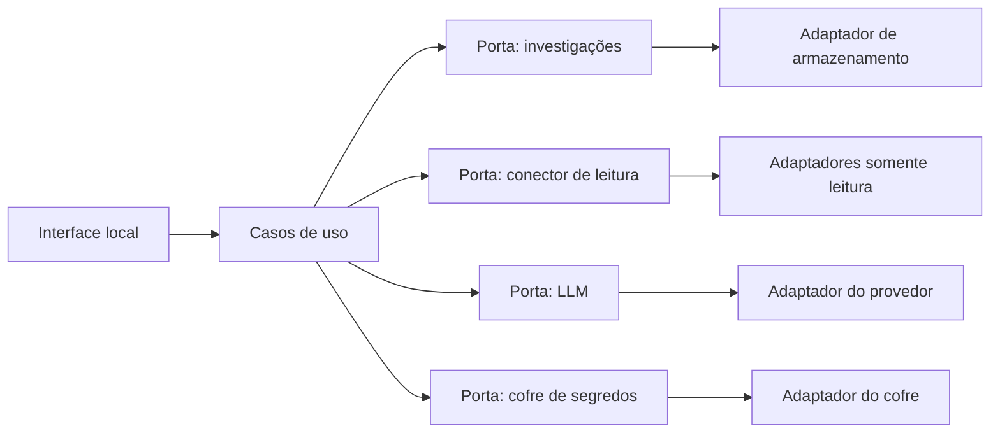

# Arquitetura

Este documento é uma proposta. O repositório ainda não tem módulos, processos nem dependências. O que está marcado como **definido** veio dos princípios do projeto. O que está marcado como **hipótese** pode mudar antes da implementação. O que está marcado como **pendente** bloqueia a etapa que depender dele.

## Definido

- O sistema começa local.
- Cada integração externa nasce somente leitura e não ganha escrita por padrão.
- Não existe componente que aplique correção ou altere produção.
- Segredos ficam fora do código, dos logs, dos prompts e do Git.
- Incluir uma integração nova não deve exigir reescrever o núcleo.
- A estrutura deve permanecer simples de testar e de manter.

## Conceitos

Uma **porta** é um contrato pequeno: o que o restante do sistema pode pedir, sem dizer qual produto externo responde. Um **adaptador** é a implementação desse contrato para um sistema concreto.

Exemplo de porta, ainda sem código: “dado um identificador de conexão e um pedido de leitura, devolva bytes ou texto”. GitHub, SFTP ou um banco seriam adaptadores diferentes da mesma porta. A investigação não sabe qual deles foi usado.

Uma **investigação** é o registro do caso. Uma **evidência** é um fato anexado a esse caso, com origem e momento. Uma **análise** é o texto devolvido pelo LLM sobre um contexto escolhido. Uma **conexão** é o cadastro de um sistema consultável. O **segredo** é a credencial, guardada fora desse cadastro.

**Redação** é o passo que mascarar segredos antes de logar ou de montar um prompt.

## Forma proposta

Hipótese: um monólito modular. Um único programa local, dividido por responsabilidade. Microserviços dariam isolamento, e também processo, rede e operação a mais, cedo demais para um protótipo de uma máquina.

Os casos de uso são o centro. Eles criam e retomam investigações, pedem leituras e solicitam análises. Eles dependem das portas, não de GitHub, SQLite ou de um fornecedor de modelo.

A interface fica na borda. Trocar uma linha de comando por uma página local, mais adiante, não deve mudar o que é uma investigação.

Os adaptadores ficam na outra borda. Um conector novo é um adaptador novo. Ele não recebe permissão de escrita porque a porta não tem essa operação.

## O que cada borda pode ver

Hipótese de fronteira, importante para segurança:

- O cadastro da conexão guarda nome, tipo, destino e a referência do segredo. Não guarda o segredo.
- Só o adaptador que vai consultar a fonte pede o segredo ao cofre, no momento da leitura.
- O LLM recebe texto já redigido. Não recebe a conexão, o cliente do sistema externo nem a credencial.
- A análise volta como dado da investigação. Nenhum módulo a interpreta como comando.

Hipótese adicional: a evidência guardada é uma cópia do que foi lido, com data e identificação da conexão. A análise posterior usa essa cópia. Uma consulta nova só acontece se o operador pedir. Isso torna a investigação repetível e limita o que segue para o modelo.

## Alternativas consideradas

| Tema | Alternativa | Por que não é a hipótese atual |
| --- | --- | --- |
| Estrutura | Microserviços, um por integração | Mais peças para operar do que o problema local pede. |
| Estrutura | Módulos sem porta comum | Cada integração passaria a ser um caso especial dentro da investigação. |
| Primeiro LLM | Agente com ferramentas, livre para consultar fontes | Aumenta a chance de leitura inesperada e de vazamento para o prompt. A hipótese é uma chamada explícita, com contexto escolhido. |
| Evidência | Ler a fonte de novo a cada análise | O contexto muda entre uma análise e outra, e fica mais difícil saber o que o modelo viu. |

A porta comum é a hipótese recomendada porque atende ao princípio de adicionar integrações sem reescrever o sistema.

## Persistência, interface e linguagem

Nada disso está escolhido.

Persistência local, quando a etapa 1 começar, tem três caminhos habituais:

- Arquivos em formato simples. Poucos conceitos, fracos para busca.
- SQLite. Um arquivo local, com consulta, sem servidor separado.
- Um servidor de banco já na primeira etapa. Capacidade a mais antes de existir dado real.

Interface:

- Linha de comando. Menos camadas para aprender o domínio.
- Página web só nesta máquina. Mais próxima de um uso contínuo, com HTTP e interface a manter.

Linguagem: TypeScript, Python e Go são candidatos razoáveis. A escolha muda bibliotecas e o modo de testar, não o desenho das portas. Fica pendente de propósito, para a pessoa que vai manter o código participar da decisão.

Identificadores de código em inglês e documentos em português são uma hipótese de convenção, não uma decisão fechada.

## Cofre de segredos

Pendente. Opções a comparar na etapa em que a primeira credencial existir:

- Variáveis de ambiente em arquivo local ignorado pelo Git.
- Cofre do sistema operacional.
- Arquivo cifrado fora do repositório.

As três podem implementar a mesma porta. A escolha não deve vazar para os casos de uso.

## Integrações futuras

Bancos de dados, FTP/SFTP, GitHub e Portainer entram, cada um, como adaptador da porta de leitura. O mapeamento do que “leitura” significa em cada um ainda não existe. Exemplos do que precisará ser decidido na hora, e só então:

- Banco: quais comandos contam como leitura.
- FTP/SFTP: listar e baixar, sem envio e sem remoção.
- GitHub: ler repositório e metadados, sem push e sem abrir pull request.
- Portainer: ler estado e logs, sem reiniciar, alterar stack ou mudar configuração.

Não há ordem entre eles.

## Hospedagem remota

Fora do desenho atual. Quando chegar, autenticação, exposição de rede e o lugar dos segredos precisam de decisão própria. O monólito local não deve ganhar essas peças antecipadamente.

## Pendências que a arquitetura não resolve

1. Linguagem do primeiro protótipo.
2. Interface da primeira etapa: linha de comando, web local, ou biblioteca sem interface ainda.
3. Armazenamento local da etapa 1.
4. Provedor de LLM e se a chamada pode sair da máquina.
5. Mecanismo do cofre.
6. Confirmação humana do contexto antes do envio ao modelo. A arquitetura recomenda que sim; o produto ainda pergunta.
7. Contrato mínimo da evidência: quais campos são obrigatórios.
8. Primeira fonte real, se for um diretório local, um arquivo de exemplo ou um sistema já usado no trabalho.
