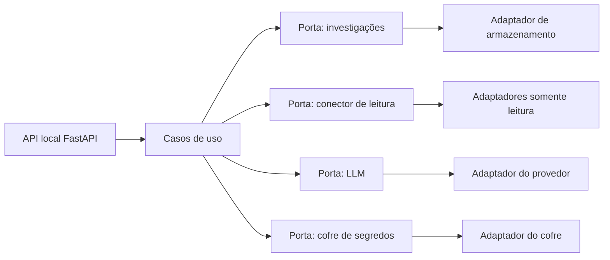
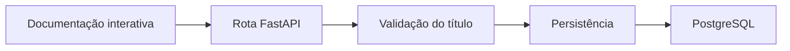

# Arquitetura

Este documento registra a forma do Forge. O que está marcado como **definido** já vale. O que está marcado como **hipótese** pode mudar. O que está marcado como **pendente** bloqueia a etapa que depender dele.

## Definido

- O sistema começa local.
- Cada integração externa nasce somente leitura e não ganha escrita por padrão.
- Não existe componente que aplique correção ou altere produção.
- Segredos ficam fora do código, dos logs, dos prompts e do Git.
- Incluir uma integração nova não deve exigir reescrever o núcleo.
- A estrutura deve permanecer simples de testar e de manter.
- A primeira implementação usa Python, FastAPI e PostgreSQL.
- A execução prevista usa o Compose com o projeto `forge_system` e os serviços `backend`, `frontend` e `postgres`.
- Na primeira execução, o Compose sobe somente o `postgres`. O `backend` roda na máquina.
- A interface dessa implementação é a documentação interativa do FastAPI.
- O uso é individual, nesta máquina.
- A primeira funcionalidade cria uma investigação e a consulta pelo identificador.
- Essa implementação não conecta sistemas externos, não chama LLM, não recebe upload e não analisa log.

## Conceitos

Uma **porta** é um contrato pequeno: o que o restante do sistema pode pedir, sem dizer qual produto externo responde. Um **adaptador** é a implementação desse contrato para um sistema concreto.

Exemplo de porta, ainda sem código: “dado um identificador de conexão e um pedido de leitura, devolva bytes ou texto”. GitHub, SFTP ou um banco seriam adaptadores diferentes da mesma porta. A investigação não sabe qual deles foi usado.

Uma **investigação** é o registro do caso. Uma **evidência** é um fato anexado a esse caso, com origem e momento. Uma **análise** é o texto devolvido pelo LLM sobre um contexto escolhido. Uma **conexão** é o cadastro de um sistema consultável. O **segredo** é a credencial, guardada fora desse cadastro.

**Redação** é o passo que mascara segredos antes de logar ou de montar um prompt.

## Forma proposta

Hipótese: o `backend` é um monólito modular, um programa só, dividido por responsabilidade. Os containers separam a interface, a API e o banco. Um container por integração seria processo e rede a mais nesta fase.

Os casos de uso são o centro. Eles criam e retomam investigações, pedem leituras e solicitam análises. A hipótese é que dependam das portas. PostgreSQL, no serviço `postgres`, é o armazenamento aprovado para o início. GitHub e o fornecedor de LLM continuam fora desta etapa.

A API fica no serviço `backend`. A tela do `frontend` existe e ainda não chama essa API. Quando a ligação for configurada, ela não muda o que é uma investigação.

Os adaptadores ficam na outra borda. Um conector novo é um adaptador novo. Ele não recebe permissão de escrita porque a porta não tem essa operação.

## O que cada borda pode ver

Hipótese de fronteira, importante para segurança:

- O cadastro da conexão guarda nome, tipo, destino e a referência do segredo. Não guarda o segredo.
- Só o adaptador que vai consultar a fonte pede o segredo ao cofre, no momento da leitura.
- O LLM recebe texto já redigido. Não recebe a conexão, o cliente do sistema externo nem a credencial.
- A análise volta como dado da investigação. Nenhum módulo a interpreta como comando.

Hipótese adicional: a evidência guardada é uma cópia do que foi lido, com data e identificação da conexão. A análise posterior usa essa cópia. Uma consulta nova só acontece se o operador pedir. Isso torna a investigação repetível e limita o que segue para o modelo.

## Alternativas consideradas

| Tema | Alternativa | Por que não é a hipótese atual |
| --- | --- | --- |
| Estrutura | Microserviços, um por integração | Mais peças para operar do que o problema local pede. |
| Estrutura | Módulos sem porta comum | Cada integração passaria a ser um caso especial dentro da investigação. |
| Primeiro LLM | Agente com ferramentas, livre para consultar fontes | Aumenta a chance de leitura inesperada e de vazamento para o prompt. A hipótese é uma chamada explícita, com contexto escolhido. |
| Evidência | Ler a fonte de novo a cada análise | O contexto muda entre uma análise e outra, e fica mais difícil saber o que o modelo viu. |

A porta comum é a hipótese recomendada porque atende ao princípio de adicionar integrações sem reescrever o sistema.

## Execução local

Definido:

- O projeto do Compose se chama `forge_system`.
- O serviço `backend` executa a API FastAPI. Não há outro container de API.
- O serviço `frontend` mostra a tela escura. Ela é React com Tailwind, compilada pelo Vite para arquivos estáticos. A navegação cobre investigação, automações, log local, conexões e configurações. As listas ficam vazias e a tela não chama a API. A documentação interativa do FastAPI continua disponível no `backend`.
- Na primeira execução, somente o `postgres` sobe pelo Compose. O processo do `backend` roda na máquina e alcança o banco por `localhost`.
- O serviço `postgres` executa o PostgreSQL que guarda os dados do Forge.
- O `backend` fala com o `postgres`. A fala do `frontend` com o `backend` ainda não está configurada.
- Na rede do Compose, o nome do serviço é o endereço. O nome `postgres` vale quando o `backend` também estiver nessa rede.
- Os containers aparecem como `forge_system-backend-1`, `forge_system-frontend-1` e `forge_system-postgres-1`.
- Os dados do PostgreSQL pertencem ao serviço `postgres` e ficam fora do Git.

O `postgres` do Forge é diferente de um banco externo consultado numa investigação futura. Esse banco externo, se entrar, será um conector somente leitura.

O Compose do `postgres` está em `docker-compose.yml`. Não há `Dockerfile` do `backend`. A senha do PostgreSQL segue a regra dos segredos: fora do código, dos logs, dos prompts e do Git.

## Decisões da primeira implementação

Definido:

- Python é a linguagem do backend.
- JavaScript é a linguagem da tela. React desenha a interface, Tailwind define o tema escuro e o Vite gera os arquivos estáticos servidos pelo `frontend`.
- FastAPI expõe a API local e a documentação automática.
- PostgreSQL, no serviço `postgres`, é a persistência local.
- A primeira funcionalidade persiste uma investigação com identificador, título e data de criação.
- As rotas previstas são `POST /investigations` e `GET /investigations/{investigation_id}`.
- Conexões externas, LLM, upload e análise de log não fazem parte desta implementação.

A divisão em portas e adaptadores continua hipótese. LLM, conector e cofre não precisam existir no código enquanto essas capacidades estiverem de fora.

Identificadores de código em inglês e documentos em português continuam hipótese de convenção.

## Primeira etapa, ainda sem código

O fluxo aprovado para a primeira implementação:

Nenhum desses componentes existe no repositório. As responsabilidades previstas são:

- A documentação interativa envia o JSON e mostra a resposta.
- A rota recebe a operação de criar ou consultar.
- A validação recusa um título ausente ou vazio antes de chegar ao banco.
- A persistência grava e relê a linha com SQL parametrizado.
- O PostgreSQL guarda o registro depois que o processo da API fecha.

O formato do identificador, o tamanho máximo do título e o endereço de escuta da API continuam pendentes. Arquivos, dependências e testes previstos estão em [.specs/steps/01-create-and-read-investigation.md](../.specs/steps/01-create-and-read-investigation.md).

## Cofre de segredos

Pendente. Opções a comparar na etapa em que a primeira credencial existir:

- Variáveis de ambiente em arquivo local ignorado pelo Git.
- Cofre do sistema operacional.
- Arquivo cifrado fora do repositório.

As três podem implementar a mesma porta. A escolha não deve vazar para os casos de uso.

## Integrações futuras

Bancos de dados, FTP/SFTP, GitHub e Portainer entram, cada um, como adaptador da porta de leitura. O mapeamento do que “leitura” significa em cada um ainda não existe. Exemplos do que precisará ser decidido na hora, e só então:

- Banco: quais comandos contam como leitura.
- FTP/SFTP: listar e baixar, sem envio e sem remoção.
- GitHub: ler repositório e metadados, sem push e sem abrir pull request. A publicação de uma tarefa aprovada é uma etapa futura separada, descrita no roadmap, e não faz parte desta leitura.
- Portainer: ler estado e logs, sem reiniciar, alterar stack ou mudar configuração.

Não há ordem entre eles.

## Hospedagem remota

Fora do desenho atual. Quando chegar, autenticação, exposição de rede e o lugar dos segredos precisam de decisão própria. O monólito local não deve ganhar essas peças antecipadamente.

## Pendências que a arquitetura não resolve

1. Como o arquivo de log chega à API e o que dele fica persistido.
2. Qual programa nesta máquina escreve a análise. O texto enviado ao modelo fica na máquina. Quem opera confirma o contexto antes do envio. A resposta tem estrutura fixa e inclui a sugestão de correção. A etapa da análise guarda esse texto. Uma etapa posterior, ainda sem abertura, pode, depois de aprovação, alterar o código pelo Cursor ou devolver o SQL do banco. O SQL não é executado. Uma segunda aprovação vem antes do commit e do envio da branch.
3. Mecanismo do cofre.
4. Primeira fonte externa, quando os conectores entrarem. O log local do primeiro caso de uso não responde a essa escolha.
