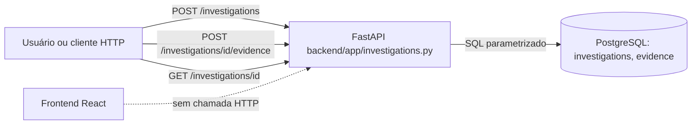

# Código legado do repositório forge (resumo)

Fase 0, Análise. Estudo sem implementação. Nenhum código foi alterado, nenhum build foi executado e nenhuma dependência foi instalada.

| Item | Valor |
| --- | --- |
| Data | 2026-11-06 (UTC) |
| Commit de referência | `92aee6d` (`main`, "ci: automação de releases com conventional commits (#11)") |
| Base factual | Relatório da FRG-32: [FRG-32-inspecao-repositorio.md](FRG-32-inspecao-repositorio.md). Não foi refeita a inspeção completa. |
| Revisar quando | Mudar a `main` de forma que altere o código legado, ou quando a decisão sobre o destino do legado for tomada |

Convenção: **[Fato]** foi verificado em arquivo do repositório. **[Inferência]** é interpretação e precisa de confirmação. **[Informado]** veio do responsável e não pode ser verificado no repositório.

**Atualização (2026-11-11):** a automação release-please foi removida. Releases são manuais; a versão fica em `pyproject.toml`. Ver [`docs/RELEASES.md`](../RELEASES.md).

## 1. Contexto

- **[Informado]** O código atual pertence a outra ideia de projeto, um "copiloto local de investigação técnica" de uso individual. Não é a base do Forge, que é uma ferramenta interna de agentes.
- **[Fato]** O legado tem um backend Python (FastAPI e PostgreSQL) com 3 rotas e 14 testes de integração, e um frontend React estático que não chama a API.
- **[Fato]** Não há agentes, filas, integração com IA, GitHub API, GHCR, Portainer nem n8n no código. Os itens existem só como rótulo ou como documentação de etapas bloqueadas.
- **[Fato]** Desde a FRG-32 entrou na `main` a automação de releases (PR #11). Ela adicionou `.github/workflows/pr-title.yml`, `.github/workflows/release.yml`, `release-please-config.json`, `docs/RELEASES.md` e o manifesto em `0.9.1`. O relatório da FRG-32 dizia que o PR ainda não estava mergeado; esta parte precisa ser lida com essa atualização.

## 2. Componentes e caminhos

| Componente | Caminho | Papel atual |
| --- | --- | --- |
| API FastAPI | `backend/app/main.py` | Cria o app, aplica `schema.sql` no startup e expõe `run()` (lê `FORGE_HOST` e `FORGE_PORT`). |
| Conexão e schema | `backend/app/db.py`, `backend/app/schema.sql` | psycopg via `DATABASE_URL`; tabelas `investigations` e `evidence`. |
| Rotas e modelos | `backend/app/investigations.py` | 3 rotas: criar investigação, anexar evidência de log e ler investigação. |
| Testes | `backend/tests/test_investigations.py` | 14 testes com PostgreSQL real. Apagam a tabela `investigations` a cada teste. |
| Frontend | `frontend/src/` | React 19 e Tailwind 4, 5 páginas e 11 componentes. Listas vazias, sem chamada HTTP. |
| Compose | `docker-compose.yml` | Serviços `postgres:16` e `frontend`, publicados em `127.0.0.1`. |
| Imagem do frontend | `frontend/Dockerfile` | Build em Node 22 e publicação com nginx 1.27. |
| Variáveis | `.env.example` | Somente placeholders. |
| Regras e processo | `AGENTS.md`, `.specs/`, `docs/` | Regras para agentes, protocolo por etapa e documentos do projeto anterior. |
| CI e releases | `.github/workflows/`, `docs/RELEASES.md` | Validação de título de PR; releases manuais (a automação release-please foi removida). |

## 3. Fluxo principal

Entrada, processamento e saída, como está hoje:



**[Fato]** A linha pontilhada indica que o frontend não chama a API. A única forma de usar o legado hoje é a API direta, pelo `/docs` do FastAPI ou por `curl`.

## 4. Configuração e variáveis (somente nomes)

- `POSTGRES_USER`, `POSTGRES_PASSWORD`, `POSTGRES_DB`: usadas pelo Compose para o serviço `postgres`. Não têm valor padrão.
- `DATABASE_URL`: usada pela API e pelos testes. Os testes apagam dados do banco apontado.
- `FORGE_HOST`, `FORGE_PORT`: obrigatórias para `run()`. Sem elas, o processo encerra com código 1.
- **[Fato]** O Python não carrega `.env` sozinho. Quem roda precisa exportar as variáveis.

Dependências externas: PostgreSQL 16. Imagens `node:22-alpine` e `nginx:1.27-alpine` no build do frontend. Nenhuma API externa.

## 5. Como executar e testar localmente

Estes passos vêm do relatório da FRG-32 e dos arquivos citados. **[Fato]** O que foi conferido nesta tarefa é a leitura dos arquivos. **Não foram reexecutados aqui**, conforme pedido de economia. O resultado de execução da FRG-32 está na seção 7 daquele relatório: 14 testes passando, API respondendo e build do frontend concluído.

Pré-requisitos: Python 3.12 (testado em 3.12.3), Node 22 (testado em 22.23.4), PostgreSQL 16. Docker é opcional.

1. Criar o ambiente virtual fora do repositório e instalar as dependências do backend:
   ```bash
   python3 -m venv /tmp/forge-venv
   /tmp/forge-venv/bin/pip install -r backend/requirements-dev.txt
   ```
2. Subir um PostgreSQL 16 de teste com usuário e senha fictícios. Use um banco descartável, porque os testes apagam a tabela.
3. Rodar os testes do backend, dentro de `backend/`:
   ```bash
   DATABASE_URL='postgresql://<USUARIO>:<SENHA-FICTICIA>@127.0.0.1:5432/<BANCO-DE-TESTE>' \
     /tmp/forge-venv/bin/python -m pytest -p no:cacheprovider -v
   ```
4. Subir a API, na mesma configuração de banco:
   ```bash
   FORGE_HOST=127.0.0.1 FORGE_PORT=8765 DATABASE_URL='postgresql://<USUARIO>:<SENHA-FICTICIA>@127.0.0.1:5432/<BANCO>' \
     /tmp/forge-venv/bin/python -c "from app.main import run; run()"
   ```
5. Frontend: copiar `frontend/` para fora do repositório, depois `npm ci` e `npm run build`. Não existem testes, lint nem typecheck.
6. Com Docker: `docker compose up` exige um `.env` local com as variáveis `POSTGRES_*`, criado a partir de `.env.example`. **[Fato]** O comportamento com variáveis vazias não foi testado.

**Lacuna para o critério de aceite:** o passo a passo ainda não foi seguido por um desenvolvedor que nunca viu o projeto. Isso fica como pendência (seção 9).

## 6. Integrações existentes

Nenhuma integração funcional. O repositório não tem integração com GitHub API, GHCR, Portainer, n8n nem IA.

## 7. Reaproveitamento para o novo Forge

Classificação **[Inferência]**, para ser usada como insumo da FRG-9. Não é decisão.

| Item | Classificação | Motivo |
| --- | --- | --- |
| Automação de releases (`release.yml`, `release-please-config.json`, `docs/RELEASES.md`) | **Arquivar / removida** | A automação release-please foi removida (2026-11-11). Convenção de Conventional Commits e o procedimento manual em `docs/RELEASES.md` permanecem. |
| Validação de título de PR (`pr-title.yml`) | **Reaproveitar** | Só checa o formato de Conventional Commits. Não depende de stack. |
| Convenções: Conventional Commits, PRs e tags semver | **Reaproveitar** | **[Fato]** Já adotadas no histórico. |
| Regras de segurança em `AGENTS.md` (leitura somente, segredo fora do Git, parar e perguntar) | **Adaptar** | Princípios úteis. O texto está acoplado ao projeto anterior. |
| Protocolo de execução (`.specs/EXECUTION_PROTOCOL.md`) | **Adaptar** | Modelo de tarefas pequenas e verificáveis. As specs `01` a `08` são do projeto anterior. |
| `.gitignore` | **Adaptar** | Cobre `.env` e o stack do legado. Faltam `.env.*`, `*.pem` e `*.key`. |
| `.env.example` | **Adaptar (padrão)** | Placeholders óbvios. As variáveis são do legado. |
| `docker-compose.yml` e `frontend/Dockerfile` | **Arquivar** | Específicos do legado. O padrão de portas em `127.0.0.1` pode ser mantido como convenção. |
| Backend (`backend/`) | **Arquivar** | Domínio de investigação. Não é base do Forge sem análise e aprovação. |
| Frontend (`frontend/`) | **Arquivar** | Tela do legado, sem chamada à API. |
| Documentos de produto, arquitetura e roadmap (`docs/`, `README.md`) | **Arquivar** | Descrevem o projeto anterior e induzem a erro se ficarem sem aviso. |

## 8. Débitos, lacunas e pontos não documentados

**Lacunas técnicas [Fato]:**

- Dependências Python sem versão fixada e sem lockfile.
- Frontend sem testes, lint nem typecheck.
- Testes apagam o banco apontado por `DATABASE_URL`. Não há banco separado para teste.
- Schema aplicado com `CREATE TABLE IF NOT EXISTS` a cada startup, sem migrações.
- API sem autenticação, sem CORS e sem limite de tamanho para o texto do log.
- Versão de Python não declarada em nenhum arquivo.

**Documentação desatualizada [Fato]** (lista completa na seção 8 da FRG-32):

- `README.md` linha 5 diz que o repositório só tem documentação.
- `docs/ARCHITECTURE.md` diz que nenhum componente existe no repositório.
- `docs/ARCHITECTURE.md` diz que o Compose sobe só `postgres`.

**Continuidade [Fato]:** repositório em conta pessoal (`danielxdrj/forge`), público, com um autor no histórico e sem `LICENSE` nem `CODEOWNERS`.

**Segredos [Fato]:** nenhum valor de segredo no working tree nem no histórico, conforme a FRG-32. Só placeholders.

**Lacunas de processo:** não há automação ativa de testes, porque não há CI de testes. O workflow de release só cria PR de release.

## 9. Decisões em aberto

Cada decisão precisa de alternativas, critérios e recomendação antes da escolha. As alternativas completas estão nas seções 12 e 13 da FRG-32.

1. **Destino do código legado.** Alternativas: A) tag e branch de arquivo e depois remoção da `main`; B) pasta `legacy/`; C) novo repositório; D) remoção direta; E) manter com aviso. **Recomendação provisória:** A, ou C se a empresa quiser separar de vez. Criar o marco antes de remover.
2. **Local da documentação técnica do Forge.** Alternativas: repositório, Notion ou ambos. **Recomendação provisória:** repositório, com resumo no Notion se houver necessidade. Se o repositório continuar público, o risco de exposição precisa ser avaliado.
3. **Versão inicial do Forge atual.** A release automática parte de `0.9.1`, herdada do legado. Alternativas: continuar a numeração ou recomeçar em `0.1.0` num repositório novo.
4. **Repositório do Forge atual.** Continuar em `danielxdrj/forge` ou migrar para organização institucional, privada.
5. **Escopo de `AGENTS.md`, `.specs/` e `docs/`.** Valem para o Forge atual ou eram do projeto anterior?
6. **Autoria.** Confirmar se os dois e-mails do histórico são da mesma pessoa e se algum deve ser trocado por conta institucional.
7. **Licença.** Definir se o repositório terá licença, caso continue público.

## 10. Recomendação

1. Tratar o código atual como legado. Não usar linguagem, banco nem estrutura dele como base do Forge sem aprovação.
2. Aproveitar a automação de releases e a validação de título de PR, que não dependem do legado, depois de confirmar a versão inicial (decisão 3).
3. Resolver o destino do legado (decisão 1) antes de escrever código do Forge atual no mesmo repositório.
4. Antes de FRG-9, levar para análise de tecnologias apenas as convenções desta seção 7.

## 11. Riscos

- Misturar legado e Forge atual na mesma árvore, o que induz decisões a partir do que existe (viés de stack).
- Remover o legado sem marco de arquivo, com perda de consulta.
- Versão `0.9.1` herdada do legado, que pode confundir o histórico do Forge atual.
- Repositório público em conta pessoal, com risco de continuidade e de exposição.
- Documentos desatualizados do legado, que podem ser lidos como arquitetura do Forge.

## 12. Perguntas em aberto

1. Qual alternativa de destino do legado será adotada, em qual tarefa, e quem aprova?
2. `AGENTS.md`, `.specs/` e `docs/` são do legado ou valem para o Forge atual?
3. O Forge atual seguirá a numeração `0.9.x` ou recomeçará?
4. Há material fora do repositório (Notion, Drive ou o diagrama de arquitetura com a visão ampla) que deva ser considerado? O diagrama não foi tocado e não está no repositório.
5. Quem vai validar o passo a passo da seção 5 seguindo somente este documento?
