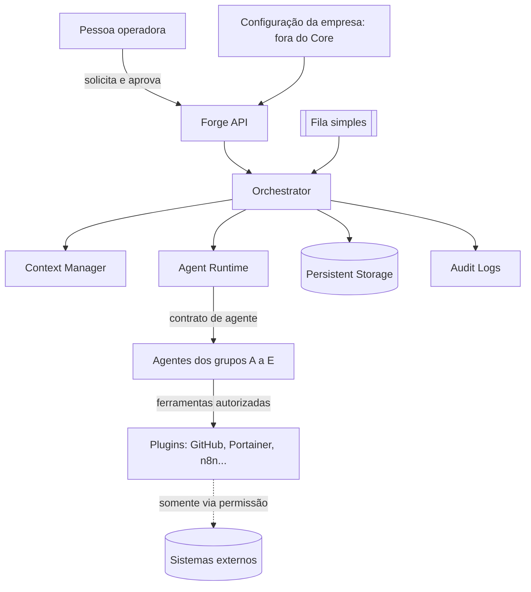

# Arquitetura-alvo do Forge (FRG-25)

Fase 0, Análise. Estudo sem implementação. Nenhum código, dependência ou build foi alterado.

| Item | Valor |
| --- | --- |
| Data | 2026-11-06 (UTC) |
| Status | Decisões aprovadas pelo responsável em 06/11/2026 (ADR-001 a 007; quatro com ajuste). Linguagem, interface e LLM continuam em aberto. |
| Insumos lidos | [FRG-23](../analise/FRG-23-resumo-codigo-legado.md), [FRG-9](../analise/FRG-9-tecnologias-reaproveitaveis.md), [FRG-32](../analise/FRG-32-inspecao-repositorio.md) e o prompt da tarefa |
| Não disponíveis | FRG-46 (não feita, opcional), FRG-47 e a página do projeto no Notion. O que dependia delas está em "Perguntas em aberto". |
| Diagrama existente (visão ampla/SaaS) | Não foi acessado, alterado nem usado. SaaS e multi-inquilino estão fora do escopo. |

Convenção: **[Fato]** verificado em arquivo do repositório. **[Informado]** vem do prompt, sem verificação. **[Inferência]/[Opinião]** juízo meu, a confirmar.

## 1. Premissas e princípios

- **[Informado]** O Forge é ferramenta interna da Ferreira & Borzone. Continuidade é requisito: outro desenvolvedor deve entender, operar e evoluir o Forge sem o autor.
- **[Informado]** Independência operacional: nenhum processo essencial depende só do Forge. Toda automação é opcional, desativável e tem procedimento manual documentado. Credenciais ficam sob controle institucional.
- **[Fato]** O código atual do repositório é legado de outro projeto (FRG-23, seção 1). Esta arquitetura parte dos requisitos, não do legado.
- **[Fato]** Não existe hoje agente, fila, plugin, integração com GitHub por API, GHCR, Portainer nem n8n (FRG-9, seção 4).
- **[Opinião]** Regra de desenho: a solução mais simples que atende a uma ferramenta interna; o que não é necessário agora fica marcado como **futuro**, não removido.

## 2. Diagrama proposto

Linha pontilhada: acesso externo. Tudo roda num único processo (ADR-001).

## 3. Fronteiras: Core × plugins × configuração da empresa

| Camada | Conteúdo | Quem altera |
| --- | --- | --- |
| Forge Core | Forge API, Orchestrator, Agent Runtime, Context Manager, Persistent Storage, Audit Logs, política de aprovação, contratos (agente, plugin) | Desenvolvedores do Forge, via PR |
| Plugins | Adaptadores de sistemas externos (GitHub, Portainer, n8n) atrás de um contrato; cada um declara as operações que oferece | Desenvolvedores, via PR |
| Configuração da empresa | Definição de agentes, prompts, permissões, repositórios, políticas, limites de custo, procedimentos manuais. Arquivos versionados; segredos fora do Git | Responsáveis, via PR em local separado (ADR-005) |

## 4. Componentes e justificativa

| Componente | Necessário agora? | Por quê / adiamento |
| --- | --- | --- |
| Forge API | Sim | Ponto único de entrada (solicitar, consultar, aprovar). Interface (web, CLI, chat) segue pendente. |
| Orchestrator | Sim | Transforma solicitação em tarefa e conduz as etapas e os pontos de aprovação. |
| Agent Runtime | Sim | Executa um agente conforme o contrato (seção 5), com permissões e limites. |
| Context Manager | Sim, mínimo | Monta o contexto de entrada de cada agente, com redação de segredos. Memória longa é futura. |
| Persistent Storage | Sim | Tarefas, estados, aprovações, resultados (ADR-004). |
| Audit Logs | Sim | Quem pediu, quem aprovou, o que o agente fez. Requisito de continuidade e segurança. |
| Plugin Registry | Sim, simples | Lista de plugins e operações a partir de arquivos; sem carregamento dinâmico remoto. |
| Integração com GitHub | Sim | Leitura de repositórios e, com aprovação, branch e PR. Pendente: GitHub App × token (ADR-007). |
| Queue / Event Bus | Sim, simples | Exigida pela FRG-40 e pela Fase 1: fila em processo ou no banco, sem sistema pesado (ADR-002). |
| Portainer, n8n | **Futuro** | Etapa de Entrega/Operações. n8n é opcional. |

Grupos de agentes (A Gestão de tarefas, B Engenharia, C Entrega e releases, D Operações, E Automações) são **conjuntos de configurações de agente**, não componentes de código. **[Opinião]** Começar por A e B; C, D e E depois, sem reordenar as fases do planejamento.

## 5. Contrato mínimo de agente

Um agente é uma definição declarativa (arquivo versionado na configuração) mais, se preciso, código em plugin. Campos:

1. **Identificação**: nome, descrição, responsável, versão, `ativo` (liga/desliga).
2. **Contexto de entrada**: o que recebe (tarefa, trechos de repositório, evidências), sempre após redação de segredos.
3. **Ferramentas autorizadas**: lista explícita de operações de plugin; o que não está listado é negado.
4. **Permissões**: leitura ou escrita por ferramenta; escrita exige aprovação (seção 6).
5. **Resultado**: formato estruturado (resumo, artefatos, pendências, custo).
6. **Logs**: cada chamada de ferramenta e decisão vai para Audit Logs.
7. **Limites**: tempo, tokens/custo máximo por execução.
8. **Procedimento manual equivalente**: link para o documento de como fazer sem o agente.

**Adicionar um agente:** criar o arquivo de definição, listar ferramentas, declarar o procedimento manual, abrir PR, aprovar. Sem alterar o Core.

## 6. Fluxo ponta a ponta

solicitação → tarefa → investigação → implementação → validação → PR → release → deploy

| Etapa | Quem executa | Aprovação humana |
| --- | --- | --- |
| Solicitação e tarefa | Pessoa + agente do grupo A | Confirmar a tarefa |
| Investigação | Agente (leitura) | Não (somente leitura) |
| Implementação | Agente (altera código em branch isolada) | Sim, antes de gravar fora do ambiente isolado |
| Validação | CI e agente | Revisão da pessoa |
| PR | Agente abre o PR | Sim, antes de criar branch/PR remoto |
| Release | Manual, uma por PR (tag e GitHub Release), conforme [`docs/RELEASES.md`](../RELEASES.md). Versão em `pyproject.toml`. | Sim, quem opera cria a release |
| Deploy | Futuro (GitHub Actions/Portainer) | Sim, sempre |

**[Opinião]** Operações críticas (escrita remota, release, deploy, SQL de escrita) sempre exigem aprovação explícita; a política detalhada continua pendente (pergunta 3).

## 7. Persistência, auditoria, segurança e custos

- **Persistência:** ADR-004. Auditoria em tabela/arquivo append-only, sem edição pelo agente.
- **Menor privilégio:** credencial por plugin, com escopo mínimo, em cofre sob controle da empresa. Valor nunca no Git, em log ou em prompt.
- **Isolamento:** agentes que alteram código rodam em diretório/contêiner descartável, sem acesso a segredos de produção.
- **Redação:** todo texto que sai do processo (log, erro, prompt) passa por redação de segredos.
- **Custos:** limite por execução e por período, contagem de tokens no resultado, alerta e parada ao atingir o teto. Valores do limite são pendentes (pergunta 5).

## 8. Desativar agentes e automações

- Cada agente/automação tem `ativo` e uma chave global de desligamento (padrão já existente: `FORGE_AUTOMATION_ENABLED` em `src/forge_core/config.py`).
- Cada um aponta para um procedimento manual em `docs/` (por exemplo, [como abrir release](../RELEASES.md)).
- Teste de continuidade: com tudo desativado, as etapas do fluxo continuam possíveis à mão, usando GitHub, GitHub Actions e Portainer diretamente.

## 9. Reaproveitamento do legado

Conforme FRG-9: reaproveitar convenções e CI sem dependência do legado (Conventional Commits, `pr-title.yml`, ações fixadas por SHA, placeholders de `.env.example`, portas em `127.0.0.1`). **Não** adotar backend, schema, frontend nem Compose do legado. Destino do legado, versionamento (`0.9.x` × `0.1.0`) e repositório institucional continuam abertos (FRG-9, seção 7).

## 10. Plano incremental (sem reordenar fases)

1. Fixar decisões desta proposta e a stack (aprovação).
2. Núcleo mínimo: contrato de agente, Agent Runtime, Orchestrator, Storage e Audit Logs, com um agente de leitura (grupo B) e logs.
3. Plugin GitHub somente leitura; depois escrita (branch/PR) com aprovação.
4. Agentes do grupo A e B completos; documentação de operação e de criação de agentes.
5. C (releases), D (Portainer), E (n8n), cada um quando a fase correspondente começar.

## 11. Decisões

| ADR | Decisão | Recomendação | Status |
| --- | --- | --- | --- |
| [001](adr/ADR-001-estilo-arquitetural.md) | Estilo arquitetural | Monólito modular | Aprovado (06/11/2026) |
| [002](adr/ADR-002-comunicacao-entre-componentes.md) | Comunicação | Chamada direta no Core; fila simples já na fundação | Aprovado com ajuste (06/11/2026) |
| [003](adr/ADR-003-estrategia-execucao-agentes.md) | Execução dos agentes | Runtime próprio fino sobre agente de código/LLM por adaptador | Aprovado com ajuste (provisório até FRG-46) (06/11/2026) |
| [004](adr/ADR-004-persistencia.md) | Persistência | PostgreSQL (alvo; SQLite só no protótipo) atrás de repositório | Aprovado com ajuste (06/11/2026) |
| [005](adr/ADR-005-core-x-configuracao.md) | Core × configuração | Repositório de configuração separado, versionado | Aprovado (06/11/2026) |
| [006](adr/ADR-006-aprovacao-e-desativacao.md) | Aprovação e desativação | Aprovação para escrita; chave `ativo` + manual | Aprovado (06/11/2026) |
| [007](adr/ADR-007-integracao-github.md) | Integração com GitHub | GitHub App ou token fine-grained (FRG-21), após criar a organização | Aprovado com ajuste (06/11/2026) |

**Continuam abertas (não assumidas):** **linguagem e frameworks; interface (web, CLI, chat); LLM e motor de agentes;** integração com Portainer; política de aprovação detalhada; transferência de manutenção; destino do legado; versionamento; repositório institucional; licença; local de CI/deploy; uso de n8n.

## 12. Riscos

- Escolher stack por inércia do legado: mitigado por não adotá-lo (FRG-9).
- Agente com escrita indevida: mitigado por aprovação e menor privilégio, mas depende de a política ser fechada.
- Custo de LLM sem teto: depende de definir limite.
- Dependência de pessoa: mitigada por contrato declarativo, documentação e procedimento manual; exige disciplina de manter ambos atualizados.
- Sem FRG-46, ADR-003 tem base fraca; revisar quando existir.

## 13. Perguntas em aberto

1. Qual linguagem/framework? Há preferência de equipe ou restrição (depende da página do projeto no Notion, não acessada).
2. Qual interface inicial: web, CLI, chat?
3. Quais operações são "críticas" e quem aprova cada uma (Notion: Segurança, Regra de planejamento dos agentes)?
4. Requisitos não funcionais (disponibilidade, volume, retenção de logs): não acessados.
5. Teto de custo por execução e por mês.
6. Qual LLM/fornecedor é permitido e como se garante que dados sensíveis não saem?
7. Quem assume a manutenção quando o autor sair e onde ficam as credenciais institucionais?
8. Existe instância de n8n e Portainer acessível? Onde rodam CI e deploy?

## 14. Fontes

Arquivos do repositório citados acima, na `main` em 2026-11-06. Nenhuma documentação externa foi consultada; afirmações sobre ferramentas externas são inferência.
