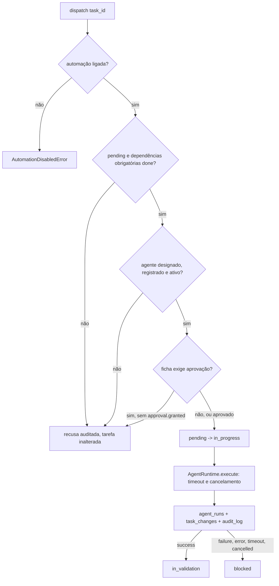

# Agentes e Orchestrator (FRG-24, ADR-011)

Stdlib apenas. Nenhuma IA: o provedor ficará atrás de `ProviderAdapter` (só interface, `provider.py`).

## Regra de segurança desta entrega
A aprovação humana **não autentica quem aprova** (registra o ator informado). Por isso **nenhum agente real com permissão `write` ou `critical` pode ser registrado até existir a tarefa de autenticação de aprovadores.** O único agente registrado é o `echo` (`read`). `AgentRegistry.register` recusa qualquer agente que exija aprovação; `allow_privileged=True` é só para testes.

## Arquivos
```
agents/spec.py          AgentSpec (ficha), AgentContext, AgentOutcome, Agent, Permission
agents/registry.py      AgentRegistry (registro; recusa agentes privilegiados)
agents/runtime.py       AgentRuntime: thread, timeout, cancelamento, erros tratados
agents/orchestrator.py  Orchestrator: dispatch, aprovação, propose/apply_split, adaptador de fila
agents/provider.py      ProviderAdapter (interface)
agents/echo.py          agente de teste, com a ficha no docstring
```

## Fluxo de despacho

`done` é decisão humana (`in_validation -> done`).

## Contrato
```python
@dataclass(frozen=True)
class AgentSpec:          # a ficha: preencha todos os campos
    name; responsibility; scope; tools; permissions; execution
    version="0.1.0"; timeout_seconds=60.0; active=True

class MeuAgente:
    spec = AgentSpec(...)
    def run(self, ctx: AgentContext) -> AgentOutcome: ...
```
- **Entrada:** `ctx.task` (tarefa), `ctx.actor`, `ctx.cancel_event` (cheque em trabalhos longos), `ctx.log(msg)` (redigido).
- **Saída:** `AgentOutcome(status="success"|"failure", summary, artifacts, pending, usage=None, cost=None)`.
- **Erros:** qualquer exceção vira `error` e só o **tipo** é gravado (a mensagem pode ecoar a tarefa). Para registrar um motivo, levante `AgentFailure("texto seguro")` (passa por `redact()`).
- **Permissões:** só `read` despacha direto; qualquer outra, desconhecida ou vazia exige aprovação (e, hoje, não pode ser registrada).

## Ficha do agente (obrigatória, junto ao código)
Responsabilidade; escopo; ferramentas autorizadas; permissões; forma de execução; comunicação com o Forge (contexto de entrada, eventos, resultado); registro de atividades; critérios de validação; manutenção. A ficha do `echo` está no docstring de `echo.py`.

## Como adicionar um agente
1. Crie `agents/meu_agente.py` com a ficha no docstring, o `AgentSpec` (só `read`, enquanto não houver autenticação) e `run`.
2. Registre: `registry = default_registry(); registry.register(MeuAgente())`. O `Orchestrator` não muda.
3. Designe a tarefa: `create_task(..., assignee_kind="agent", assignee_id="meu-agente")`.
4. Teste com o padrão de `tests/core/test_orchestrator.py` e atualize esta documentação.

## Exemplo completo
```python
repo = open_repository(url); tasks = TaskService(repo)
orch = Orchestrator(repo, default_registry(), settings=settings)
t = tasks.create_task("Ecoar", "pessoa:ana", objective="oi", assignee_kind="agent", assignee_id="echo")
res = orch.dispatch(t.id)            # DispatchResult(run_status="success", task_status="in_validation", ...)
queue = SqlJobQueue(repo, settings); orch.enqueue(queue, t.id, "pessoa:ana")
queue.run_once(orch.job_handler(), "agente:worker")   # via fila (retry, lease)
orch.propose_split(t.id)             # só propõe; orch.apply_split(t.id, titulos, "pessoa:ana") cria
orch.grant_approval(t.id, "pessoa:ana")   # somente para agentes que exigem aprovação
```

## Configuração
| Variável | Obrigatória | Finalidade |
| --- | --- | --- |
| `FORGE_AGENTS_DISABLED` | não | lista separada por vírgula de agentes desativados |
| `FORGE_AUTOMATION_ENABLED` | não (true) | `false` bloqueia todo despacho (procedimento manual equivalente: executar a tarefa à mão e mudar o status com `TaskService`) |

## Troubleshooting
`DispatchRefusedError` e a linha `agent.dispatch` com `error:` no `audit_log` dizem o motivo (não pronta, sem agente, desativado, aprovação pendente). Execuções ficam em `agent_runs` (`SELECT agent, status, error FROM agent_runs`). Tarefa `blocked` após falha/timeout: corrija e volte a `pending`. Job `failed` por recusa: resolva e use `orch.enqueue` de novo.

## Limitações e próximos passos
Timeout e cancelamento não matam a thread (FRG-6). Aprovação sem autenticação. Um despacho por vez por tarefa. Sem agentes reais, sem provedor de IA. Sugestões de tarefa futura: **autenticação de aprovadores** (pré-requisito para qualquer agente `write`/`critical`), isolamento de execução (FRG-6), leitura de definições de agente por arquivo, implementação do `ProviderAdapter`, agentes reais (FRG-43, 44, 22, 16, 19).
