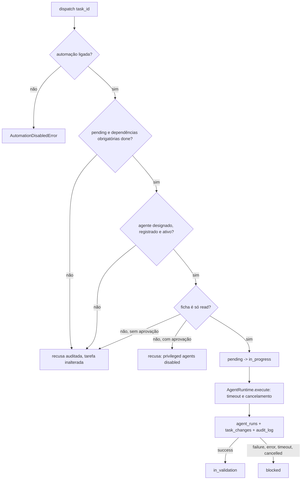

# Agentes e Orchestrator (FRG-24, ADR-011)

Stdlib apenas. Nenhuma IA: o provedor ficará atrás de `ProviderAdapter` (só interface, `provider.py`).

## Fronteira de segurança e limitações reais
- **Hoje apenas agentes `read` executam** (só o `echo` existe). `AgentRegistry.register` recusa sempre agente que não seja só `read`; `AgentRuntime.execute` também recusa se chamado direto; o `Orchestrator` nunca despacha privilegiado, mesmo com aprovação (recusa auditada: "privileged agents disabled until approver authentication"). Não existe flag nem construtor que mude isso.
- **O registro de aprovação não é autenticação.** `grant_approval(task_id, "pessoa:x")` grava o ator informado e não libera nada. A política (`approval.decide`), o registro e a reserva atômica de uso único (`ApprovalLedger`, tabela `approval_consumptions`) existem para o contrato ficar pronto.
- **Para liberar agentes privilegiados no futuro:** autenticação de aprovadores e uma nova ADR. O consumo da aprovação vale mesmo se a execução falhar; retry ou replay exigem nova aprovação.
- **Timeout e thread:** em timeout/cancelamento o contexto é selado (`ctx.log()` vira no-op), qualquer resultado tardio é descartado e nada mais é gravado em `agent_runs`, `task_changes` ou `audit_log`. A thread **não é morta**: I/O, rede ou outros efeitos externos que ela já esteja fazendo não podem ser interrompidos sem isolamento (FRG-6). Isso é independente da autorização: o `echo` só lê.
- **Gate global:** automação desligada e `FORGE_AGENTS_DISABLED` valem em `dispatch`, `job_handler` e no runtime; sem `settings`, o ambiente é lido como no `start()`.
- As limitações acima foram aceitas pelo gestor de projetos, a quem o usuário delegou as decisões técnicas.

## Arquivos
```
agents/spec.py          AgentSpec (ficha), AgentContext, AgentOutcome, Agent, Permission
agents/approval.py     política `decide`, ApprovalLedger (concessão e reserva atômica)
agents/registry.py      AgentRegistry (registro; recusa agentes privilegiados)
agents/runtime.py       AgentRuntime: thread, timeout, cancelamento, erros tratados
agents/orchestrator.py  Orchestrator: dispatch, aprovação, propose/apply_split, adaptador de fila
agents/provider.py      ProviderAdapter (interface)
agents/echo.py          agente de teste, com a ficha no docstring
```

## Fluxo de despacho

`done` é decisão humana (`in_validation -> done`).

## Contrato
```python
@dataclass(frozen=True)
class AgentSpec:          # a ficha: preencha todos os campos
    name; responsibility; scope; tools; permissions; execution
    version="0.1.0"; timeout_seconds=60.0; active=True

class MeuAgente:
    spec = AgentSpec(...)
    def run(self, ctx: AgentContext) -> AgentOutcome: ...
```
- **Entrada:** `ctx.task` (tarefa), `ctx.actor`, `ctx.cancel_event` (cheque em trabalhos longos), `ctx.log(msg)` (redigido).
- **Saída:** `AgentOutcome(status="success"|"failure", summary, artifacts, pending, usage=None, cost=None)`.
- **Erros:** qualquer exceção vira `error` e só o **tipo** é gravado (a mensagem pode ecoar a tarefa). Para registrar um motivo, levante `AgentFailure("texto seguro")` (passa por `redact()`).
- **Permissões:** só `read` pode ser registrado e executado; qualquer outra (inclusive desconhecida ou vazia) é recusada.

## Ficha do agente (obrigatória, junto ao código)
Responsabilidade; escopo; ferramentas autorizadas; permissões; forma de execução; comunicação com o Forge (contexto de entrada, eventos, resultado); registro de atividades; critérios de validação; manutenção. A ficha do `echo` está no docstring de `echo.py`.

## Como adicionar um agente
1. Crie `agents/meu_agente.py` com a ficha no docstring, o `AgentSpec` (só `read`; qualquer outra permissão é recusada pelo registro) e `run`.
2. Registre: `registry = default_registry(); registry.register(MeuAgente())`. O `Orchestrator` não muda.
3. Designe a tarefa: `create_task(..., assignee_kind="agent", assignee_id="meu-agente")`.
4. Teste com o padrão de `tests/core/test_orchestrator.py` e atualize esta documentação.

## Exemplo completo
```python
repo = open_repository(url); tasks = TaskService(repo)
orch = Orchestrator(repo, default_registry(), settings=settings)
t = tasks.create_task("Ecoar", "pessoa:ana", objective="oi", assignee_kind="agent", assignee_id="echo")
res = orch.dispatch(t.id)            # DispatchResult(run_status="success", task_status="in_validation", ...)
queue = SqlJobQueue(repo, settings); orch.enqueue(queue, t.id, "pessoa:ana")
queue.run_once(orch.job_handler(), "agente:worker")   # via fila (retry, lease)
orch.propose_split(t.id)             # só propõe; orch.apply_split(t.id, titulos, "pessoa:ana") cria
orch.grant_approval(t.id, "pessoa:ana")   # só registra; NÃO libera agente privilegiado (sem autenticação)
```

## Configuração
| Variável | Obrigatória | Finalidade |
| --- | --- | --- |
| `FORGE_AGENTS_DISABLED` | não | lista separada por vírgula de agentes desativados |
| `FORGE_AUTOMATION_ENABLED` | não (true) | `false` bloqueia todo despacho (procedimento manual equivalente: executar a tarefa à mão e mudar o status com `TaskService`) |

## Troubleshooting
`AgentError: privileged agents disabled...` ao registrar: o agente precisa ser só `read`. `DispatchRefusedError` e a linha `agent.dispatch` com `error:` no `audit_log` dizem o motivo (não pronta, sem agente, desativado, aprovação pendente). Execuções ficam em `agent_runs` (`SELECT agent, status, error FROM agent_runs`). Tarefa `blocked` após falha/timeout: corrija e volte a `pending`. Job `failed` por recusa: resolva e use `orch.enqueue` de novo.

## Limitações e próximos passos
Veja a seção "Fronteira de segurança e limitações reais". Um despacho por vez por tarefa. Sem agentes reais, sem provedor de IA. Sugestões de tarefa futura: **autenticação de aprovadores** (pré-requisito para qualquer agente `write`/`critical`), isolamento de execução (FRG-6), leitura de definições de agente por arquivo, implementação do `ProviderAdapter`, agentes reais (FRG-43, 44, 22, 16, 19).
